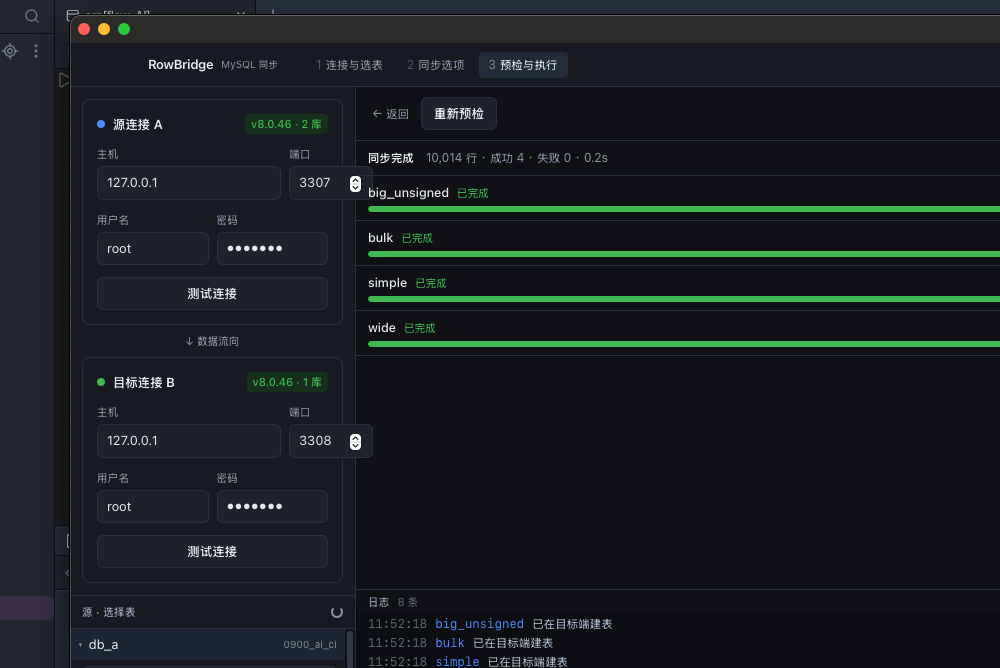

# RowBridge

一个 macOS 端的 MySQL 数据同步工具。选中 A 库的若干表，按**单列整型主键分批**把数据搬到 B 库同名表；目标表不存在时按源表结构自动创建。



<sub>启动界面：[docs/screenshots/start.png](docs/screenshots/start.png)</sub>

## 它解决的场景

- 把某几张表从一个库搬到另一个库（同实例跨库、跨实例都行）
- 目标端还没建表，不想手写 DDL
- 大表不想一次读进内存，也不想 `mysqldump` 全量重来
- 中断了想接着跑，而不是从头再来

## 核心设计

同步语句是：

```sql
SELECT `c1`,`c2` FROM `db_a`.`a`
WHERE `id` > ?          -- 游标
ORDER BY `id` ASC       -- 必须
LIMIT ?                 -- 必须
```

两个关键点：

**`ORDER BY id` 是正确性前提，不是优化。** 下一批的游标取「本批最后一行的 id」。如果返回顺序不按 id 递增（优化器换索引、覆盖索引扫描），最后一行就不是本批最大值，中间的行会被**静默跳过且不报错**。

**这个写法不是深分页。** `WHERE id > ? ORDER BY id LIMIT n` 走主键的有序范围扫描，O(1) 定位、无 filesort；`LIMIT 1000000, n` 要扫掉前面所有行。

写入用 UPSERT（`INSERT … ON DUPLICATE KEY UPDATE`），因此**任务可以随时中断重跑** —— 断点就是目标表的 `MAX(pk)`，不需要额外存进度。

## 功能

| 能力 | 说明 |
|---|---|
| 连接管理 | 多组源/目标，密码存 macOS 钥匙串，不落盘 |
| 库表浏览 | 库 → 表，显示主键、行数估算，不兼容的表置灰并说明原因 |
| 结构预检 | 主键合法性、列兼容性、collation 差异、目标缺列、触发器 |
| 自动建表 | `SHOW CREATE TABLE` → 改写 → 执行，改写细节可视化 |
| 分批同步 | 自适应批大小、占位符上限、包大小预算、单行降级 |
| 多表并行 | 可配并发数（默认 2） |
| 实时进度 | 每表行数/游标/速率，逐条日志 |
| 取消 | 随时停止，已同步的进度保留 |
| 断点续跑 | 从目标 `MAX(id)` 继续 |
| 任务历史 | SQLite 记录任务摘要与日志 |

## 首版明确不做

- **不做 DELETE 同步**：目标端多出的行保留
- **不做 DDL 变更同步**：目标表已存在时只补数据，不 `ALTER`
- **不支持无主键 / 复合主键 / 非整型主键**：界面上置灰并说明原因
- **不做 CDC**：是一次性任务，不读 binlog
- **不做表名映射**：同名进同名出
- 只支持 MySQL（含 MariaDB 兼容）

## 自动建表做了什么改写

`SHOW CREATE TABLE` 的输出**不能直接执行**，否则会出问题：

| 改写 | 原因 |
|---|---|
| 表名替换为目标限定名 | — |
| 删掉 `AUTO_INCREMENT=12345` | 否则目标表从源表当前值起跳，主键留大段空洞 |
| 删掉外键约束（可关） | 被引用表可能还没建，直接报 1215/1824 |
| collation 降级（可关） | 8.0 的 `utf8mb4_0900_ai_ci` 在 5.7/MariaDB 上建表失败 |

低版本不支持的语法（`CHECK`、函数索引、`DEFAULT (expr)`、`INVISIBLE`）会检测并警告，但不擅自改。

## 最小权限

```sql
-- 源端
GRANT SELECT ON db_a.* TO 'user'@'%';
-- 目标端（需要自动建表和建库时）
GRANT SELECT, INSERT, UPDATE, CREATE ON db_b.* TO 'user'@'host';
```

## 开发

需要 Node 20+、Rust 1.88+、Xcode Command Line Tools。

```bash
npm install
npm run tauri dev
```

打包 dmg：

```bash
npm run tauri build
# 产物在 src-tauri/target/release/bundle/dmg/
```

### 引擎可以脱离 UI 单独跑

引擎在 `crates/rowbridge-core`，不依赖 Tauri。UI 只是它的外壳。

```bash
cargo build -p rowbridge-core --bins

# 列出库
./target/debug/rowbridge-cli --src-host 127.0.0.1 --src-port 3306 \
  --src-user root --src-pass secret schemas

# 只预检，看建表语句
./target/debug/rowbridge-cli ... sync --from db_a --to db_b --table a --dry-run

# 真的同步，4 表并行
./target/debug/rowbridge-cli ... sync --from db_a --to db_b \
  --table a --table b --table c --table d --parallel 4

# 断点续跑
./target/debug/rowbridge-cli ... sync --from db_a --to db_b --table big --cursor resume
```

### 测试

```bash
cargo test -p rowbridge-core     # 单元测试
./tests/e2e/run.sh               # 端到端，需要 Docker
```

e2e 会起两个 MySQL 容器（3307/3308），覆盖 26 项断言：主键空洞、负数主键、`u64::MAX`、全数据类型逐列指纹比对、10000 行按 137 分批、自适应批大小回归、UPSERT 幂等、断点续跑、不支持主键的拦截、外键剥离、并行、同实例跨库。

## 打包

`npm run tauri build` 在部分环境会卡在 Tauri 自带的 `bundle_dmg.sh`（它用 Finder 的 AppleScript 摆图标，无 GUI 会话时会超时）。`.app` 本身没问题，直接生成 dmg 即可：

```bash
npm run tauri build -- --no-bundle
STAGE=$(mktemp -d)
cp -R target/release/bundle/macos/RowBridge.app "$STAGE/"
ln -s /Applications "$STAGE/Applications"
hdiutil create -volname RowBridge -srcfolder "$STAGE" -ov -format UDZO \
  target/release/RowBridge_aarch64.dmg
```

## 已知限制

- 不是一致性快照：每批独立读，同步期间的并发写入会造成个别行新旧混合。低峰期搬家够用；需要 snapshot 请用 `START TRANSACTION WITH CONSISTENT SNAPSHOT`，但代价是长事务和 undo 膨胀。
- dmg 未签名，首次打开需右键 → 打开。
- 目标表有触发器时，行数可能不符（预检会警告）。

## 许可

MIT
